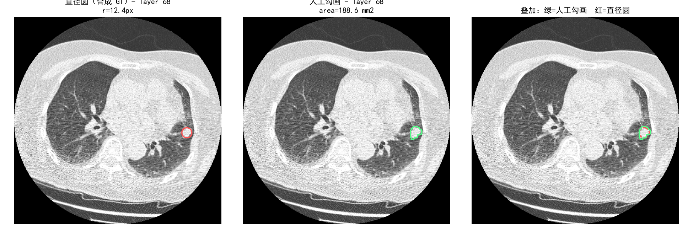
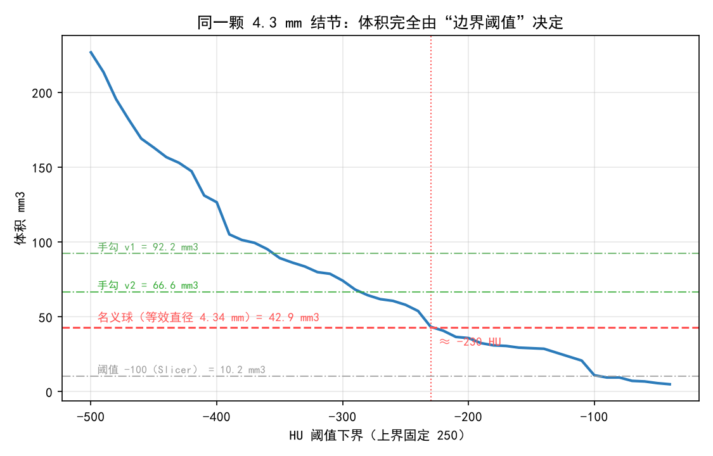
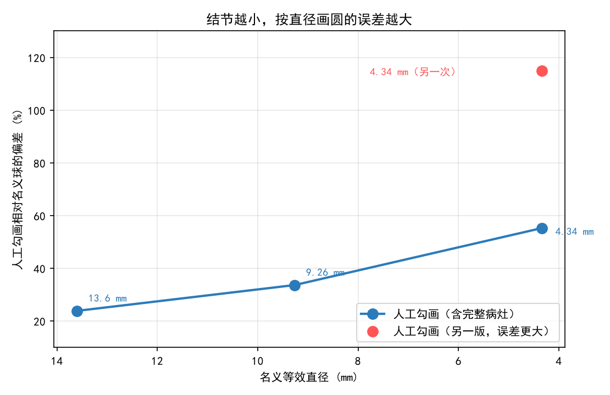

# 项目2 · CT 肺结节分割（LUNA16 + MONAI）

> 状态：2D 原型，全链路已跑通。GT 为**伪标签**，指标不可作为分割精度对外引用。

## 一、这个项目在做什么

把 3D CT 按轴位切成 2D 切片，在 64×64 的 patch 上训练 U-Net，输出结节区域的 mask。

需要注意的是：patch 是围绕 annotations 给出的结节中心裁的，所以模型学到的是**"这个结节多大"**，不是"在哪里"——位置在裁 patch 时就白送了。

## 二、数据

- LUNA16 subset0：18 个 CT（`.mhd` + `.raw` 全配对），13 个有结节，5 个 0 结节（可作负样本）

- 结节 18 个，直径 4.34–17.69 mm

- z 间距 0.5–2.5 mm，各向异性差异大

- 每个结节取中心层 ±1 共 3 层，裁 64×64 patch

## 三、标签（mask）是怎么来的 —— 重要

LUNA16 是**检测**数据集，只提供两样东西：

- 结节中心的**世界坐标**（coordX/Y/Z，毫米）

- 一个**等效直径**（diameter_mm，毫米）

**它不提供任何像素级标注。** 所以 mask 不是医生画的，是算出来的：

1. 世界坐标 → 体素坐标（`TransformPhysicalPointToIndex`），得到圆心

2. 半径 R = (diameter_mm / 2) / Spacing_xy —— 把毫米换算成像素

3. 在 64×64 的格子上，把所有到圆心距离 ≤ R 的点设为 1

## 四、伪标签的局限

1. **GT 是圆，不是边界**：等效直径只有一个数，而真实结节常不规则、分叶、有毛刺，画的圆和真实轮廓本来就对不上。

2. **每层画同一个圆 → 三维上是"柱"不是"球"**：z 间距和 xy 间距差 1.5–5 倍，逐层复制会在 z 方向失真。

3. **位置是白送的**：patch 围绕已知中心裁，任务里没有"找结节"这一步；真实场景（整张 CT 里找病灶）从未被测过。

4. **只有 18 个结节**：指标会剧烈波动。

5. **没有验证集**：全部 patch 都参与训练，评估也在同一批上。

### 定量证据：人工勾画 vs 直径圆

上面的问题是定性描述。为了量化，用 3D Slicer 在同一颗结节（CT `658609808059`，等效直径 13.6 mm，第 68 层，中心 x=426 / y=286）上手工勾画了一次，和"按直径画的圆"直接对比：



| 项目 | 数值 |
|---|---|
| 人工勾画体积 | **1628.8 mm³**（4326 体素，跨 9 层） |
| 按等效直径算的球 | **1316.1 mm³**（直径 13.60 mm） |
| 差值 | **+312.7 mm³（+23.8%）** |
| 最大层截面积 | 人工 188.6 mm² vs 圆 145.2 mm² |

**推论一：Dice 的上限（3D 实测，不是估算）**

把人工勾画分别和两种"合成 GT"做三维对比：

| 对比对象 | 体积 (mm3) | **3D Dice** |
|---|---|---|
| 人工勾画（4326 体素，9 层） | 1628.8 | — |
| 理想球体（R = 6.8 mm，真三维球） | 1332.5 | **0.766** |
| **训练实际使用的 GT（3 层圆盘，cz±1）** | 552.3 | **0.465** |

- 即使对着"理想球体"，3D Dice 也只有 **0.766**；先前用单层 2D 面积估出的 0.87 偏乐观。
- 而模型**真正学过的那套 mask** 只有 3 层，与真实勾画的 3D Dice 仅 **0.465**——一半都不到。

**所以 0.825 这个训练集 Dice 的含义是**：模型很擅长复现"那 3 层圆盘"，而那 3 层圆盘本身只覆盖真实病灶的一小部分。这个数字既不是边界精度，也不该被当成"分割能力"。

**推论二：训练只用了三分之一的结节。** 这颗结节实际跨 **9 层**（64–72），而训练时的 patch 只取了中心层 ±1，即 **3 层**（67–69）。也就是说：

- 这颗结节有 **6/9 = 67% 的切片从未进入训练集**
- 训练用的"3D GT"其实是一个 **3 层厚的圆盘叠层**（3 × 1.25 mm = 3.75 mm 厚），能覆盖的体积只有 3 × 1.25 × 145.2 ≈ **544 mm³**，是真实结节体积（1628.8 mm³）的 **1/3**

**所以问题不只是"圆的形状不对"，而是"训练时只看过这个结节的三分之一"。**

原因是 LUNA16 给的直径是**等效直径**——把不规则的结节摊成一个体积相同的球得到的一个数；真实结节的边界是分叶的、不规则的，不是圆。

> 另一个观察：手工勾画的质心在 (426.9, 285.3)，与 LUNA16 标注中心 (426, 286) 相差不到 1 个像素。这说明**中心坐标是可信的**，不可信的是"由直径推出来的形状"，以及"只取 3 层"这个取样策略。

### 边界定义决定体积：同一颗结节差 12 倍

上面那组是大结节（13.6 mm）。换成同一 CT 里的**小结节**（4.3 mm，第 57 层，中心 x=408 / y=337），只改"边界用什么 HU 阈值"这一件事（上界固定 250、取最大连通域、20×20×7 窗口）：

| 阈值下界 | 体素 | 体积 (mm3) | 等效直径 | 覆盖层数 |
|---|---|---|---|---|
| -400 | 336 | 126.5 | 6.23 mm | 6 |
| -300 | 197 | 74.2 | 5.21 mm | 5 |
| -200 | 95 | 35.8 | 4.09 mm | 3 |
| -100 | 29 | 10.9 | 2.75 mm | 3 |



- LUNA16 的"等效直径 4.34 mm"对应 **42.9 mm3**；反查曲线，它**等价于阈值约 -230 HU 的等值面**。也就是说，数据集的"边界"隐含了一个从未被写下来的阈值约定。
- 两次手工勾画（92.2 / 66.6 mm3）分别落在 **-350 和 -300 HU** 附近——**手抖的那 1.4 倍差异，等价于把阈值挪了 40 HU**。
- **结论**：在这种小结节上，"体积"不是客观量，而是"边界定义"的函数。不写明窗、阈值、边缘层规则，两个标注者给出的数就不可比。

> 附一条被剔除的数据：Slicer 里阈值设 -400/250 时，输出 `Max HU` 恒为 -102（与设定上界 250 矛盾），三次重跑不变，故不采用，改用脚本按固定参数计算。**异常值查不通就剔除并记录，不硬凑。**

### 误差随结节变小而放大（三个结节、同一套勾画规则）

在 **3D Slicer** 里手工勾画同一批 CT 中的三个结节（同一窗、同一笔刷规则、按病灶外缘勾），和"按等效直径算出的球"对比：

| 结节 | 名义直径 | 名义球体积 (mm3) | 人工勾画 (mm3) | 相对偏差 |
|---|---|---|---|---|
| `808059` 大 | 13.60 mm | 1316.1 | 1628.8 | **+23.8%** |
| `478441` 中 | 9.26 mm | 416.0 | 555.7 | **+33.6%** |
| `808059` 小（第 1 次） | 4.34 mm | 42.9 | 92.2 | **+114.9%** |
| `808059` 小（第 2 次） | 4.34 mm | 42.9 | 66.6 | **+55.2%** |



三条可直接写进标注规范的结论：

1. **误差随结节变小单调放大**：+23.8% → +33.6% → +55%，同样的勾画规则，越小的病灶偏差越大。
2. **小病灶的两次勾画能差 1.4 倍**（92.2 vs 66.6），说明 4 mm 量级的病灶**单次手工勾画不足以作为金标准**。
3. **"等效直径"是一个压缩过的描述**：它只保留了一个数，丢掉了形状、分叶、空洞等全部信息；尺寸越小，这一丢越致命。

> 补充一条操作层面的观察：`478441` 那颗 9.26 mm 的结节中心是低密度的（环形/空洞样），按外缘勾画（空洞计入）得到 555.7 mm3。行业主流做法也是**按外缘勾、空洞计入病灶体积**，但实性成分通常另设标签——这一条必须写进规范，否则同一人隔天勾会差 30%。


## 五、结果 · 以及它不能说明什么

配置：MONAI `UNet`（2D，channels 16–256，`num_res_units=2`）、`DiceCELoss(sigmoid=True)`、Adam 1e-3、batch 4、100 epoch、RandFlip + RandRotate(±11.5°)。

| 配置 | Dice（训练集 patch / 阈值 0.5 / 无验证集） |
|---|---|
| 20 epoch，无增强 | 0.262 |
| 100 epoch + 翻转/旋转 | 0.825 |

**说明**：模型能从 CT 灰度里估出结节的大小，并按"以中心画圆"这条规则画出来；在这批训练数据上估得比较准。

**不能说明**：

- 不能在**没见过的 CT** 上也有这个水平（没有验证集，无从判断）

- 不能说明它会**找**结节（位置白送，从没测过）

- 不能说明**边界**准（GT 本身是算出来的圆）

> 过拟合是一个诊断，诊断需要对照（验证集）。这里没有对照，所以只能说：这个数不构成泛化证据。

## 六、下一步

1. **拆验证集**：按 CT 拆（8:2），不能按切片拆——相邻切片几乎一样，会泄漏，指标虚高。

2. **换真 GT**：LUNA16 的 888 个 CT 全部来自 LIDC-IDRI（1018 例），LIDC 有 4 位医生的像素级轮廓（XML）。同一套 2D 管线，只换 mask 来源就能做真分割。

3. **或者走检测路线**：LUNA16 本来就是检测数据集，指标应报敏感度 @ 每例假阳性数（FROC）。

## 七、复现

本仓库里出现的每一个数字，都由 `code\` 下的脚本产出，**2026-11-12 已实跑验证**。

```powershell
cd code
D:\Anaconda3\python.exe verify_3ddice.py     # 3D Dice 0.766 / 0.465
D:\Anaconda3\python.exe compare_seg.py       # 人工 1628.8 mm³，+23.8%
D:\Anaconda3\python.exe thr_volumes.py       # 阈值扫掠 126.5 → 10.9 mm³
```

| 脚本 | 产出 | 对应本文哪一节 |
|---|---|---|
| `verify_3ddice.py` | 3D Dice 0.766（理想球）/ 0.465（训练用 3 层圆盘） | 四·推论一 |
| `compare_seg.py` | 人工勾画 1628.8 mm³、包围盒、质心 | 四·定量证据 |
| `thr_volumes.py` | 阈值扫掠 126.5 / 74.2 / 35.8 / 10.9 mm³ | 四·边界定义 |
| `volume_curve.py` | 体积–阈值曲线，反推 −230 HU | 四·边界定义 |
| `nav_nodule.py` / `nav_nodule3.py` | 结节层号与中心坐标（勾画前定位用） | 三 |
| `compare_seg_small.py` / `small_three.py` | 小结节多版本对比 | 四·误差随尺寸 |

- **环境**：Anaconda3（`D:\Anaconda3`），MONAI 1.6.0 + torch + SimpleITK + scipy
- **数据**：`E:\luna16`（LUNA16 subset0）；换机器时改脚本顶部的 `LUNA` 常量
- **训练**：`code\train_pipeline.ipynb`（造 mask → 训练 → 推理 → Dice 评估）
- **标注资产**：`slicer\`（Slicer 场景 + 导出的 labelmap，同目录用相对路径）
- **注意**：SimpleITK 读不了中文路径，所以项目目录是英文的 `project2-lung-seg`


## 八、一致性验证 · intra-rater（2026-11-17）

同一人、同一颗 13.60 mm 结节、**间隔 8 天**、同一条标注规范，独立复勾一次：

| | 体素 | 体积 (mm³) | 层数 | 平均 HU |
|---|---|---|---|---|
| 第 1 次 | 4326 | 1628.8 | 9 | −169 |
| 第 2 次 | 2813 | 1059.1 | 8 | −46 |

- **3D Dice = 0.769**，**体积差 = −35.0%**
- 差异不是整体缩小，而是边界漂移：各层相对变化 **−12% ~ −47%**，最大层从 68 漂到 67，最上层整层未勾
- 解读：**手工自由勾画的重复误差（35%）大于体积随访要检出的增长（约 20–25%）→ 该方法不能用于体积随访**；要用于随访必须改用固定阈值/半自动

明细见 `一致性报告_intra_rater.md`，脚本 `code\intra_rater.py`，图 `figs\intra_rater.png`。

> 与第四节合起来，本项目的两条结论都是方法学层面的：
> 1. **训练 GT 不能用于分割**（合成圆，3D Dice 仅 0.465）
> 2. **手工勾画不能用于体积随访**（自身重复误差 35% > 待检信号 25%）


## 九、真 GT：与 LIDC 的 4 位医生对比（2026-11-18）

LUNA16 没有医生轮廓，但它的 888 个 CT 全部来自 **LIDC-IDRI**，而 LIDC 有 4 位放射科医生的逐层轮廓。本项目通过 `pylidc` 的注释库（`data\pylidc.sqlite`，24.9 MB，含 1018 例扫描 / **6859 条医生标注** / 41406 条轮廓）取出了真轮廓——**不需要下载任何 DICOM 影像**。

- 本机 18 个 CT **全部匹配成功（18/18）**，质心误差 0.15–0.55 mm
- 提取脚本：`code\lidc_mask.py`，用法：`python code\lidc_mask.py --seriesuid <完整UID>`

### 9.1 手工勾画与医生共识的逐对对照

同一颗 13.60 mm 结节，两个手勾版本 × 4 位医生 = 8 个配对（脚本 `code\lidc_compare.py`）：

| 手勾版本 | 体积 (mm³) | vs 医生 Dice（均值） | 相对医生均值 (1611.1) |
|---|---|---|---|
| **第 1 次** | 1628.8 | **0.848**（0.832–0.860） | **+1.1%** |
| 第 2 次 | 1059.1 | 0.776（0.709–0.815） | −34.3% |

**第 1 次与 4 位医生的共识高度一致**：Dice 0.848、体积只差 1.1%，落在 1454.9–1892.0 的区间内。

### 9.2 关键发现：两种差异性质不同，不能混为一谈

| | 医生之间 | 本人两次之间 |
|---|---|---|
| 跨度 | **30%**（1454.9→1892.0） | **35%**（1628.8→1059.1） |
| 方向 | **双向**（上下都有） | **单向**（第 2 次对 4 位医生**全部**偏低） |
| 性质 | 随机分散 | **系统性偏差** |

**所以不能说"手工量体积天然有 35% 噪声"。** 更准确的说法是：

> 第 1 次勾对了（Dice 0.848、+1.1%）；第 2 次把规范里"宁少不多"执行过头，**系统性低估 34%**，落到所有医生之外。
> **这是规则设计的缺陷，不是测量的随机噪声。**

对应修订：规范 3.2 的"宁少不多"应改为**"边缘层按上下对称性判断"**，而不是一律少勾。

⚠️ 措辞纪律：说「对照」不说「验证」；说「4 位标注者」不说「金标准」；不说"和医生一致"，说**「落在 4 位医生标注的区间内」**（且仅第 1 次如此）。


### 9.3 「0 结节 CT」不等于没有结节

某例在 LUNA16 里标 0 个结节，**LIDC 的医生标了 5 个**（体积 84–126 mm³）。

**正确表述**：「0 结节」= 没有满足 LUNA **纳入标准**（≥3 mm 且四位医生中至少三人认定）的结节，**不等于这张 CT 里没有结节**。

> 这条直接影响「负样本」的用法：把这类 CT 当"纯背景"来训练，等于把真结节当负样本喂进去。

### 9.4 对第四节的补充

第四节说"训练 GT 是合成圆，3D Dice 只有 0.465"。现在可以再补一句更根本的：

> **分割任务连"唯一真值"这个前提都不成立**——4 位医生彼此就差 30%。任何用单一人/单一规则生成的 mask，都只是这个区间的某一个点。


