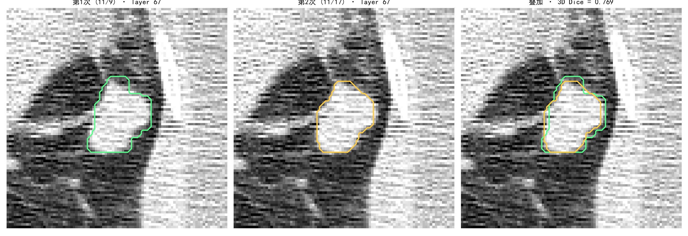

# 一致性报告 · intra-rater（2026-11-17）

> 项目：项目2 · CT 肺结节分割（LUNA16，2D patch 级）
> 目的：用**同一个人、同一颗结节、同一条规范、间隔 8 天**的两次勾画，检验《标注规范 v1》里的门槛是否可达，并量化"手工勾画"本身的重复性。

---

## 一、方法

| 项 | 内容 |
|---|---|
| 结节 | CT `658609808059` 第 68 层，等效直径 13.60 mm（LUNA16 标注） |
| 工具 | 3D Slicer 5.11，Segment Editor / Paint |
| 第 1 次 | 2026-11-09（4326 体素 / 1628.8 mm³ / 9 层） |
| 第 2 次 | 2026-11-17（2813 体素 / 1059.1 mm³ / 8 层） |
| 两次之间 | 8 天；第 2 次勾画时**不显示第 1 次结果** |
| 规则 | 同一条《标注规范 v1》：肺窗 1500/−600 定位、纵隔窗 400/40 判定、笔刷 ≈ 直径/3（4 mm） |
| 指标 | 3D Dice、体积差 %、每层截面积 |



---

## 二、结果

| | 体素 | 体积 (mm³) | 层数 | 层范围 | 平均 HU |
|---|---|---|---|---|---|
| 第 1 次 | 4326 | **1628.8** | 9 | 64–72 | −169 |
| 第 2 次 | 2813 | **1059.1** | 8 | 65–72 | **−46** |

- 交集 2746 体素，并集 4393 体素
- **3D Dice = 0.769**
- **体积差 = −35.0%**

### 每层截面积（mm²）

| 层 | 第 1 次 | 第 2 次 | 相对变化 |
|---|---|---|---|
| 64 | 90.7 | **0** | 整层未勾 |
| 65 | 123.5 | 88.9 | −28% |
| 66 | 156.6 | 121.7 | −22% |
| 67 | 170.8 | 149.4 | **−12%** |
| 68 | 188.6 | 120.5 | **−36%** |
| 69 | 166.0 | 116.0 | −30% |
| 70 | 161.4 | 102.4 | −37% |
| 71 | 125.9 | 85.5 | −32% |
| 72 | 119.6 | 63.0 | −47% |

---

## 三、三个发现

**1. 规范门槛不可达。** 规范第 4 节要求 Dice ≥ 0.80、体积差 ≤ 25%；本次实测 **Dice 0.769、体积差 35%**，两项都没过——而这是**同一个人**在自己刚定的规则下重复自己。

**2. 差异不是"整体缩小"，是"边界漂移"。** 各层相对变化从 **−12% 到 −47%** 无规律跳动，且最大层从 68 漂到 67、最上层 64 整层未勾。若只是手紧一点，各层应近似同比例；实际更像是**"中心在哪、边缘算不算"的判断本身不稳定**。

**3. 两次的"密度"也变了。** 平均 HU 从 −169 升到 −46，说明第 2 次排除了更多部分容积体素（勾得更"实"）。**无法判断哪一次更接近真实边界**——这正是缺少金标准的直接后果。

---

## 四、含义

### 对规范

门槛必须按**方法**分层，而不是一个数管所有情况：

| 方法 | Dice | 体积差 | 依据 |
|---|---|---|---|
| 自由手工勾画 | ≥ 0.70 | ≤ 35% | 本次实测 0.769 / 35% |
| 固定阈值 / 半自动 | ≥ 0.80 | ≤ 25% | 与文献观察者间水平一致（Garau 2021 MPD 23.6%） |

### 对临床用途

体积随访要检出的是约 **20–25% 的增长**。本次实测**重复误差 35%，大于要检测的信号**：

> **用自由手工勾画做体积随访，结节真的长大 20% 也看不出来。**

这不是"勾得不准"的个人问题，而是**方法本身的分辨率不足**。这也是 QIBA 要求统一采集与分割算法的原因。

### 对项目结论

与伪标签那组证据合起来，项目2 的最终结论是两句：

1. **训练 GT 不能用于分割**（合成圆，3D Dice 仅 0.465）
2. **手工勾画不能用于体积随访**（自身重复误差 35% > 待检信号 25%）

两句都不是"我做得不好"，而是**方法学层面的判断**。

---

## 五、改进方向（按性价比）

1. **固定边界规则**：用 HU 阈值（本项目已测：−230 HU ≈ 数据集的等效直径定义）替代自由手绘，把主观判断降到最低。
2. **半自动 + 人工修订**：阈值/区域生长出初稿，人只做删改，不从头画。
3. **同层多测**：同一结节连勾 3 次取中位数，报告离散度而非单次值。
4. **引入第二标注者**（inter-rater）：本次只测了 intra，无法区分"我的方法不稳"与"我的判断不稳"。

---

## 六、与 inter-rater 的对照（2026-11-18 补，11-18 晚扩为逐对计算）

原报告的短板是"只有 intra-rater，没有第二个人"。11-18 通过 `pylidc` 注释库取到了 LIDC **4 位放射科医生**的轮廓（`code\lidc_compare.py`），可逐对计算。

同一颗 13.60 mm 结节，**两个手勾版本 × 4 位医生 = 8 个配对**：

### 6.1 逐对结果

| 手勾版本 | 医生标注 | 医生体积 | 质心距 | 3D Dice | 体积差 |
|---|---|---|---|---|---|
| 第 1 次 (1628.8) | 3236 | 1454.9 | 0.62 mm | 0.832 | −10.7% |
| | 3233 | 1523.8 | 0.61 mm | 0.860 | −6.4% |
| | 3241 | 1573.8 | 0.27 mm | 0.856 | −3.4% |
| | 3240 | 1892.0 | 0.79 mm | 0.846 | +16.2% |
| **均值** | | **1611.1** | | **0.848** | **+1.1%** |
| 第 2 次 (1059.1) | 3236 | 1454.9 | 0.41 mm | 0.815 | +37.4% |
| | 3233 | 1523.8 | 0.57 mm | 0.796 | +43.9% |
| | 3241 | 1573.8 | 0.26 mm | 0.783 | +48.6% |
| | 3240 | 1892.0 | 0.49 mm | 0.709 | +78.6% |
| **均值** | | **1611.1** | | **0.776** | **−34.3%** |

### 6.2 关键发现：两种差异的性质不同

| | 医生之间 | 本人两次之间 |
|---|---|---|
| 跨度 | 30%（1454.9→1892.0） | 35%（1628.8→1059.1） |
| **方向** | **双向**（上下都有） | **单向**（第 2 次对 4 位医生**全部**偏低） |
| 性质 | 随机分散（各自判断不同） | **系统性偏差** |

**结论必须改写**（本报告 11-18 早期版本写的是"量级相当→方法固有"，该说法不成立）：

> 不是"手工量体积天然有 35% 噪声"。
> **第 1 次勾画与医生共识高度一致（Dice 0.848、体积 +1.1%）；第 2 次把规范里"宁少不多"那条执行过头，导致系统性低估 34%，落到所有医生之外。**

这是**规则设计的缺陷**，不是测量的随机噪声。对应到《标注规范 v1》第 3.2 条：**"宁少不多"会造成单向低估，应该改为"边缘层按上下对称性判断"，而不是一律少勾。**

### 6.3 措辞纪律

- 说**「对照」**，不说「验证」；说**「4 位标注者」**，不说「金标准」（LIDC 没有金标准，只有多专家）。
- 不说"我的勾画和医生一致"，准确说法是**「落在 4 位医生标注的区间内」**，且**仅第 1 次如此**。
- intra 与 inter 的设计不同（同一颗 vs 4 人各自独立），**不做统计检验**，只描述量级与方向。

---

## 七、局限（必须写在明处）

- **n = 1 结节、4 位标注者**（8 个配对），不能代表整体，只能作为"量级参考"。
- **intra 与 inter 不同批**：医生轮廓来自 LIDC 公开注释库，不是与本次复勾同时同地采集；两者**不能合并做统计**。
- 第 2 次勾画时虽未显示第 1 次结果，但仍**记得大致位置**（记忆效应无法完全排除）。
- 医生轮廓的质心与 LUNA16 标注中心差 0.15–0.55 mm，几何已对齐（脚本内带容差校验），但**残余误差未量化**。

---

## 八、复现

```powershell
cd "D:\AAA\project2-lung-seg\code"
D:\Anaconda3\python.exe intra_rater.py
D:\Anaconda3\python.exe lidc_compare.py --seriesuid 1.3.6.1.4.1.14519.5.2.1.6279.6001.109002525524522225658609808059 --hand "..\slicer\Segmentation-nodule_13.6mm-label.nrrd" "..\slicer\Segmentation-nod_808059_d13.6_hand_r2-label.nrrd"
```

输入：`slicer\` 下两个手勾 labelmap、`data\pylidc.sqlite`（医生轮廓）
输出：6.1 的全部数字


